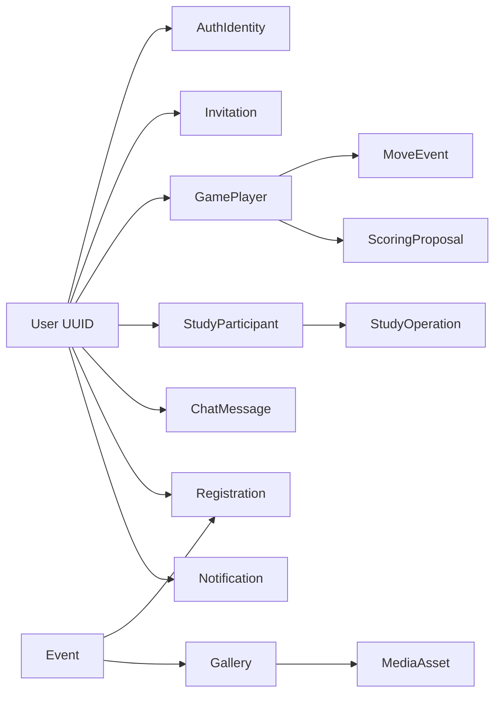

# Logical Data Architecture

**Status:** DRAFT · Model-level only. No final SQL schema, DDL, indexes or ORM migration produced.

## 1. Source of truth
PostgreSQL is authoritative for identities mapped to internal UUIDs, invitations, game state/move log, Study edits, chats, events, notification inbox, publications, moderation actions and transactional outbox. Supabase Storage holds image/file bytes, PostgreSQL stores metadata and ownership. Clerk remains authoritative for Google login/session issuance.

## 2. Candidate entity inventory
| Context | Logical entities (illustrative; not table mandate) | Core integrity requirements |
|---|---|---|
| Identity | `User`, `AuthIdentity`, `RoleAssignment`, `Profile`, `AccountDeletionRequest` | Unique external identity → internal UUID; no profile-email exposure |
| Safety | `UserBlock`, `Report`, `ReportEvidence`, `ModerationAction`, `AuditEntry` | Canonical unordered block pair or directional block with mutual enforcement; report evidence access audited |
| Invitation | `Invitation`, `InvitationDelivery`, `InvitationTransition` | Type, sender/target, settings snapshot, expiry, single terminal outcome |
| Game | `Game` (authoritative versioned state snapshot including move history), `GamePlayer` / active-game membership, optional future normalized `MoveEvent`, `ScoringProposal`, `GameResult` | One active Live game/player; immutable accepted setup; atomic one-row move state writes; reconstructable replay |
| Study | `StudyBoard`, `StudyParticipant`, `StudyOperation`, `StudyRevision` | ≤2 participants; global ordered operations; owner and hide semantics |
| Chat | `ChatThread`, `ChatParticipant`, `ChatMessage`, `MessageTombstone` | Scoped read/write permissions, one central public thread plus DMs |
| Notification | `Notification`, `NotificationDelivery` | Recipient-scoped and durable; read state |
| Events | `Event`, `Registration`, `GuestSeatHold`, `GuestVerificationToken`, `CancellationToken` | Capacity invariant counts unexpired holds and confirmed seats |
| CMS/Media | `Announcement`, `Guide`, `VideoResource`, `Gallery`, `MediaAsset`, `PublicationRevision` | Public reads limited to published items; safe file access |
| Puzzle | `Puzzle`, `PuzzlePosition`, `SolutionNode`, `FeaturedPuzzle` | Multiple branches; single manually featured puzzle semantics |
| Email/Jobs | `OutboxMessage`, `EmailAttempt`, `JobExecution` | Deduplication, retry and observable failures |

## 3. Suggested conceptual relationships

## 4. Consistency and transaction boundaries
1. **Accept Live invite:** serialize concurrent acceptance, validate invite TTL, actor status/blocking/presence, both players' Live availability; create exactly one active Live game and atomically close sibling invitations. Prefer DB-enforced uniqueness for active Live participation where representable; recheck under transaction.
2. **Commit ordinary game operation:** derive next state from current version; game engine validates legality/phase/clock; save board + move history + turn + clock + new revision together using **one conditional UPDATE of the Game state row** (`WHERE game_id = ? AND revision = ?`). Zero rows updated means stale command / conflict. Store accepted command IDs durably to recognize retries; broadcast only after commit. A standalone multi-statement transaction is not needed for this case. Complex cross-row transitions, such as invitation acceptance, use a short DB transaction. Assess JSONB snapshot size and write amplification before fixing final schema.
3. **Study operation:** check membership and operation revision; persist ordered operation with global undo semantics; two users' near-simultaneous commands resolve via serial order, never client timestamp.
4. **Reserve guest seat:** capacity computed with confirmed registrations + nonexpired holds; concurrent requests serialized (row lock/transaction). Hold expiry releases seats logically even if cleanup job delayed.
5. **Verify registration:** single-use token and current hold validated transactionally; no overbooking from delayed email link or repeated clicks.
6. **Account deletion:** auditable resumable workflow (may span transactions) anonymizes retained shared content, transfers shared Study ownership, cancels future event registrations and removes identifiers. Respect retention exception process.
7. **Notifications/email:** outbox inserted with originating business transaction, then separate delivery attempts; client must dedupe by server event ID.

## 5. Retention and erasure
- Chat: history retained until deletion according to permissions/policy, not infinite immutable archive.
- Guest event PII: purge **90 days after event**; aggregates may survive without personal data. Expired verification tokens and seat holds purge earlier by operational policy.
- Closed moderation reports: up to **one year after closure**, except justified legal holds; limit evidence exposure.
- Completed games: retain move log/replay, anonymize deleted participants; Study personal boards deleted, shared board ownership transferred to surviving partner.
- Notifications/invitation audit/operational logs require concrete retention windows in Privacy LLD (prior suggestions are not decisions).
- Backup retention, vendor deletion propagation and already-exported CSV require explicit operational controls; cannot guarantee immediate deletion from offline backups without lifecycle policy.

## 6. Versioning and migration
- Drizzle Kit migrations in version control, forward-only reviewed rollout with backup for destructive operations.
- Prefer opaque internal UUIDs, created/updated timestamps and explicit status transition fields; no public direct sequential database identifiers.
- Repositories isolate storage implementation, **not** relational constraints or semantics: changing DB engine requires new DAL plus consistency/migration work.
- Candidate index concerns: external identity uniqueness, active Live per user, invitation status/expiry, ordered game moves, Study board revision, chat thread chronology, event registration/hold TTL, notification recipient/unread. Final choices in LLD.

## 7. Data ownership and cross-module operations (v0.2)
| Domain data | Sole mutation owner | Other modules may do |
|---|---|---|
| Users, identities, roles | Identity | Query authorized identity/profile view; request suspension checks |
| Games, moves, results, game settings | Games | Request game operations through GameService; receive committed domain events |
| Game/Study invitations | Invitations (domain-specific command owner) | Notifications deliver invitations but never decide acceptance/expiry |
| Study boards, revisions, participants | Study | Account Deletion coordinator requests ownership transfer / deletion |
| Chats and private message content | Chat | Moderation requests scoped hide/remove; evidence access must be bounded and audited |
| Events, registration holds and rosters | Events | Brevo adapter delivers email but never confirms a registration |
| Notifications and read state | Notifications | Other modules request delivery through a typed interface/outbox |
| Reports, actions, suspensions | Moderation | Other modules enforce restrictions via policy interfaces |
| CMS, guides, puzzles, assets metadata | Owning Content/Puzzle/Media module | Others use read contracts and owner-provided actions |

Domain modules may share a physical PostgreSQL database but MUST NOT mutate another domain's owned tables directly from ordinary services. A narrowly scoped cross-domain coordinator may enlist module-provided operations in a common transaction when required for correctness. Exact interface signatures and DB table ownership are LLD deliverables.
