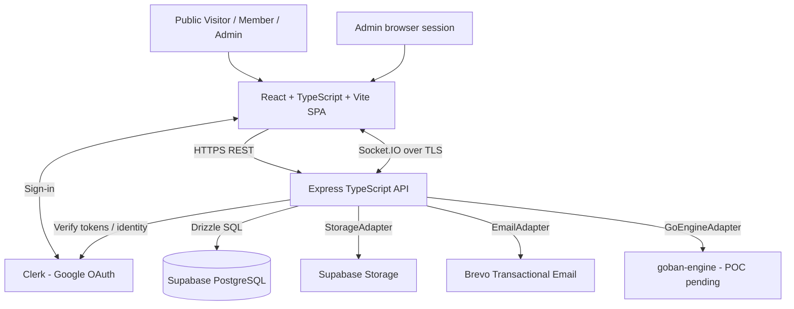
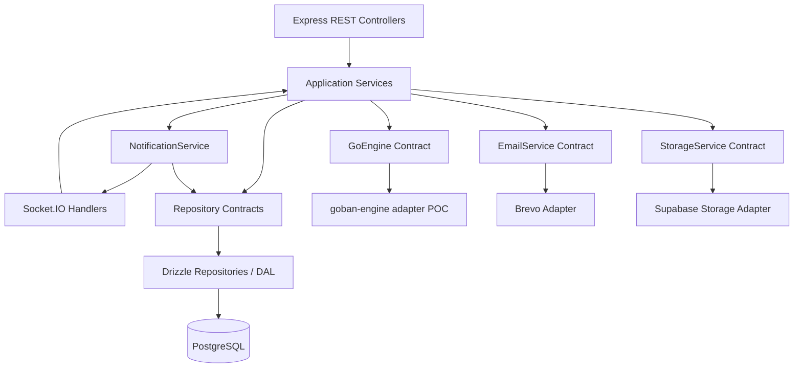

# System High-Level Design

**Status:** DRAFT v0.2 — architecture review revisions; Product Baseline v0.1 approved. Owner sign-off still required.

## 1. Goals and constraints
- A free, Hebrew-first, RTL, mobile-friendly online home for a small Southern Israel Go community (~500 weekly active projected; not a throughput guarantee).
- Full MVP encompasses identity, games, Study Boards, chat, DMs, notifications, events, CMS, guides, puzzles, galleries, admin and shop Coming Soon.
- No ELO, matchmaking, ranking, tournaments, public game lobby or in-product checkout.
- Reliable authoritative multiplayer state, recoverable from process restarts and reconnects.
- Low hosting cost, local development, and future VPS migration without redesigning domain logic.
- Accessible interaction and reduced-motion support; modern warm visual system based on the team-preferred first mockup, photographic inspiration from the third, conventional OGS-like game room.

## 2. Context diagram

## 3. Deployment topology
- Frontend: static React/Vite build on Netlify; React application also hosts `/admin` gated by client navigation and **server-enforced** authorization.
- Backend: single Node.js/Express process on Render Free MVP; HTTP API and Socket.IO share one origin/service, no Redis or distributed broker initially.
- DB and object storage: Supabase PostgreSQL + Storage via distinct domain adapters. DB migrations via Drizzle Kit.
- Authentication: Google-only Clerk. Users have internal UUID; external Clerk user IDs live in `auth_identities` mapping. Never treat an email address as a primary identity key.
- Email: Brevo behind `EmailService` adapter and durable PostgreSQL outbox.
- Only Local and Production environments in MVP. Docker Compose local. Production backup automation must be working before launch.
- Future VPS: application and PostgreSQL/object-storage implementation can be relocated; adapter boundaries help portability. Clerk and Brevo can remain managed unless explicitly replaced.

## 4. Internal architecture

- Controllers/Socket handlers validate transport and identity; **one** application service owns each business command and its invariants.
- Services depend on interfaces, not Drizzle types or cloud SDK models; dependency wiring via explicit constructors/factories, no heavy DI framework.
- Keep domain modules separate within one deployable backend (**modular monolith**). Avoid microservices, Redis, speculative queues.
- For ordinary game moves use a **single conditional PostgreSQL UPDATE** of one authoritative game state document/snapshot (including move history, phase, clocks, active player and version). The update succeeds only when `version = expectedVersion` and advances version once. No explicit multi-statement transaction is required for this single-row change.
- The game engine computes a proposed next state without mutating authoritative shared state; clients are notified **only after** the conditional write succeeds. If zero rows update, reload and reject/revalidate the command. Persist a bounded deduplication record/command ID within the game state or equivalent durable constraint so retries cannot apply a move twice. Test snapshot size and full-history rewrite cost, especially at 19×19; split history into a move table with a short transaction only if needed.
- Multi-entity operations (e.g. invite acceptance plus cancelling sibling invites, seat holds, report actions) use short PostgreSQL transactions when invariants span rows. For email, retain a minimal durable outbox where atomic commitment with the business change is required; delivery remains asynchronous and retryable.
- Side effects must not occur before commit. Failed email must not undo confirmed event registration.

## 5. Core workflows (architectural)
### Member onboarding
Frontend obtains Clerk session → backend verifies token → upserts identity mapping/internal user → first-time nickname/avatar confirmation → resume user's original intent if still authorized and current.

### Live invitation to game
Authenticated member selects board/settings (default 9×9, no clock, random colors, normal komi 6.5; optional 15m, handicap komi 0.5 and editable) → API creates expiring invite → durable notification + real-time toast → atomic accept validates invite, both player availability, mutual blocks, and sender presence → creates game and cancels conflicting invites. Server handles explicit logout cancellation and best-effort reconnect grace for unknown disconnects.

### Move and scoring
Submit command with client-generated unique command ID and expected revision → authenticate and validate player, turn, game phase, time, legality via `GoEngine` → persist the complete authoritative game state and history via one version-conditional row UPDATE → notify clients of committed version → respond to sender. On two passes scoring phase, dead stones proposed/confirmed; dispute can resume. No-winner proposal requires mutual acceptance.

### Guest event reservation
Guest submits form → capacity-safe 15-minute pending seat hold on capped events → verification token email via outbox/Brevo → click confirms only if valid, not expired, capacity state consistent → confirmation email and cancellation-token lifecycle. Guest PII purge 90 days post event subject to legal retention and known backup constraints.

### Shared Study Board
Invitation to one other member → both edit unrestricted placements/removals, server orders changes and commits revisions → global undo/redo follows committed log; persistence and recovery independent of presence → owner delete-all vs participant hide are different commands. Ownership passes to remaining participant on account deletion.

## 6. Operational quality constraints
- Site and backend tolerate Render process restart; no business-critical state exclusively in server RAM or ephemeral local filesystem.
- Explicit transaction/retry/idempotency handling for race-prone commands.
- Rate limits for auth-triggering endpoints, invitations, chat and verification emails; input sanitation and secure content handling.
- Observability: structured logs, request/correlation IDs, health endpoint, durable job failures, error metrics; never log DM bodies or secrets.
- Recoverability: database backups automated before release; verify restore and object storage recovery separately.

## 7. Scope boundaries
HLD defines architecture, not final API paths, DB columns/indexes, cron cadences, game-clock algorithm or SGF support subset. These are LLD and POC topics. See `HLD_REVIEW.md`.
